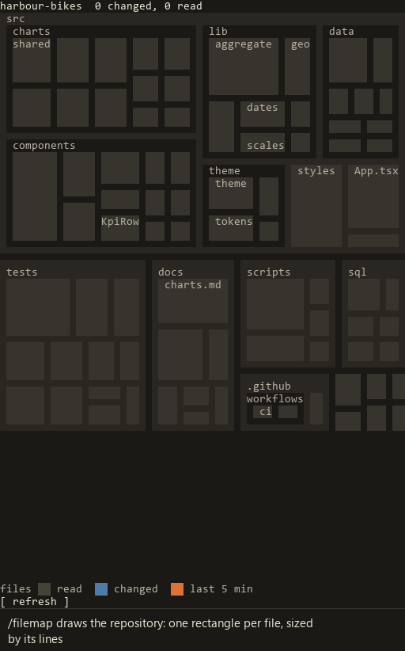

# filemap

A Claude Code mod that draws a git repository as a treemap in a side pane, so you can see at a glance which part of the codebase the agent is working on.



## What the map shows

- Each source or text file is a rectangle, grouped by folder. Its area follows the square root of its number of lines: a file of 400 lines gets twice the area of a file of 100 lines, not four times, so the long JSON files of a Power BI report crowd out the short TMDL files of its semantic model less.
- The map holds files of these types: .ts, .tsx, .js, .jsx, .mjs, .cjs, .mts, .cts, .sh, .bash, .zsh, .fish, .py, .ps1, .psm1, .cs, .csx, .rs, .go, .java, .zig, .swift, .c, .h, .cpp, .cc, .hpp, .tmdl, .dax, .md, .mdx, .css, .scss, .html, .json, .toml, .yaml, .yml, .sql, .pbir, .pbism and .pbip. It leaves out empty files, binary files, lock files, minified .js files and the folders node_modules, .venv, venv and \_\_pycache\_\_.
- A file the agent read turns grey, one step lighter than an untouched file.
- A changed file gets a blue band. The band's height is the share of the file's lines that changed since you opened the pane. Git counts the lines, so a change that is undone disappears again, and a change made by a shell command or another program counts too.
- A folder too small to show its files is one box. Its blue band covers the share of its area that the bands of its changed files would cover.
- Orange marks the files that changed in the last 5 minutes.
- The header names the busiest folders of the last 5 minutes and counts the changed and read files.
- The list under the map shows the latest files the agent read or changed, of any type, with the lines added and removed.

## Mouse

The map reads the same without a mouse. With one:

- Hover over a rectangle to see the file or folder and its change in the row under the map.
- Click a file to keep it in that row, and double-click it to open it.
- Click a folder to zoom in. Click the top row or "up" to zoom out.
- Click a row of the list to open its file.

## Install it

Type this at the prompt of Claude Code in a terminal, version 2.1.296 or later, with git 2.31 or later:

```
/plugin install filemap --marketplace vdvoorder/filemap
```

Answer `y` to add the marketplace, then pick a scope.

Then type `/filemap` to map the current repository, or `/filemap <folder>` for another one.

To load the mod from a folder instead, as when you work on it:

```
claude --plugin-dir <path to this repository>
```

## Settings

"Open files with" (`opener`) names one program that opens every file: a command on PATH, such as `code`, or the full path of a program. On macOS it can also be the name of an app, such as `Visual Studio Code`, which the mod opens with `open -a`. When the setting is empty, each file opens in the default app of its type. On Windows, .ts belongs to Media Player until you pick another default app or fill in this setting.

A file that the system would run instead of showing does not go to the default app of its type:

- Windows: a script (.py, .js, .ps1, .sh, .cmd, .bat or .vbs) or a .reg file opens in the app that opens .txt files. Another type that Windows runs, such as .exe, .msi or .lnk, does not open, and a toast says so.
- macOS: a .py, .command or .tool file opens in the text editor that `open -t` picks. Another type that macOS runs, such as .app, .pkg or an executable file without an extension, as gradlew, does not open, and a toast says so.
- Linux: a file with the execute bit, or a .jar, .jnlp, .desktop, .deb, .rpm, .snap, .flatpakref, .flatpakrepo, .AppImage or .run file, counts as a file that runs. A text file among them, such as an executable .sh script or a .desktop file, opens in the app that `xdg-mime query default text/plain` names. Any other does not open, and a toast says so.

When this setting names a program, that program opens these files too.

"Pane width" (`paneWidth`) is the number of columns of the pane beside the conversation, from 40 to 200, and 64 by default. A new value takes effect the next time you type `/filemap`.

- The pane sits beside the conversation only in the fullscreen layout, in a terminal of 110 columns or more. In a narrower terminal, or outside the fullscreen layout, it opens above the prompt as wide as the terminal.
- Claude Code keeps 24 columns for the conversation and 1 for the edge of the pane. A terminal narrower than the width plus 25 columns gives a narrower pane. The pane gets its width back when you widen the terminal.
- A width you drag the edge of a docked pane to wins over this setting, also in later sessions. Claude Code keeps one such width for the docked panes of every plugin.
- When the pane is narrower than this setting, the row under the map says why whenever it names no file or folder.
- Above about 130 columns the map can show fewer rows: the text of the map has a limit of 100,000 characters.

## Platforms

- Windows: the tests pass on Claude Code 2.1.301 with git 2.55, and the pane has been used in live sessions.
- Linux: the tests pass on Claude Code 2.1.301 with git 2.55 on Arch Linux, and there the pane draws, names the file under the pointer, and zooms in and out on a click.
- macOS: the openers are covered by unit tests only.
- The workflow in .github runs the tests on Windows, Linux and macOS with Claude Code 2.1.296.
- On Linux, a file type with no default app opens nothing and shows no message.

## Limits

- File names show their Latin, Greek, Cyrillic, Armenian and Georgian letters. Letters of other scripts, emoji and invisible characters show as `?` in the pane, and the file still opens.
- A repository whose file list passes 4 MiB gets no map, and a message says why.
- To count the changed lines, the mod keeps an uncompressed copy of each changed or untracked file in its temporary folder until the session ends. A file over 32 MiB is left out of the count and gets no copy.
- Where an organization manages Claude Code, the mod does not hear when a background task ends or when a git command outside the agent moves the index or HEAD. The map then shows such a change up to 30 seconds later.

## What it leaves alone

- Git itself writes nothing into the repository's .git folder for the mod: the mod builds its trees in a temporary folder of its own and points Git LFS there too. A clean filter that your git config sets up still runs when the mod reads a file.
- It never takes git's index lock, so a git command of the agent never fails because of the mod.
- It deletes its temporary folder when the session ends. On Linux and macOS only you can open that folder, also in a shared /tmp.

## Contributing

filemap does not accept pull requests; open an issue for bugs and ideas.

Run the tests with `claude plugin test .`. The pre-commit hook in .githooks runs the checks and needs Node 22.18 or later; turn it on with `git config core.hooksPath .githooks`.

## License

Sustainable Use License 1.0, in [LICENSE](LICENSE). You may use and change filemap for yourself, for the internal work of the company you work for, or for any non-commercial purpose, and you may share it free of charge for non-commercial purposes. Selling filemap, or shipping it or a changed copy as part of a product or service that you sell, needs a separate license from Ruben Van de Voorde.
